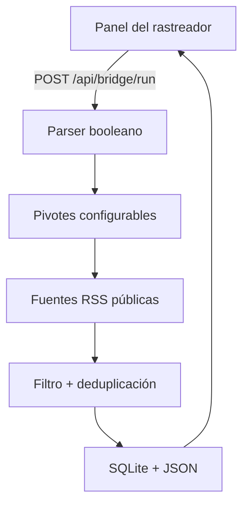

# Rastreador OSINT–BOOLEANO

Rastreador autónomo que combina consultas booleanas con descubrimiento OSINT de fuentes públicas. Es determinístico: **no importa SDK de IA, no llama modelos, no genera embeddings y no necesita claves de OpenAI, Anthropic, Google AI ni similares**.

La denominación operativa es **Rastreador OSINT–BOOLEANO**. El booleano es su capa de consulta y filtrado; OSINT es su capa de descubrimiento, verificación, deduplicación y conservación de evidencia.

## Qué resuelve

1. Recibe la expresión usada por el rastreador: `AND`, `OR`, `NOT`, frases entre comillas y paréntesis.
2. La convierte en un árbol lógico validado.
3. Genera pivotes de búsqueda reproducibles desde términos y alias configurados manualmente.
4. Consulta Google News RSS y los feeds públicos definidos en `config/sources.json`.
5. Reaplica localmente el filtro booleano para que la lógica no dependa del buscador externo.
6. Normaliza, elimina URLs de seguimiento, deduplica notas sindicadas y conserva las fuentes corroborantes.
7. Asigna relevancia y confianza mediante reglas visibles, no mediante un modelo.
8. Guarda la corrida y la evidencia en SQLite.
9. Devuelve JSON al panel y muestra los resultados con el componente web incluido.
10. Envía cada alerta nueva por correo a los destinatarios activos, sin revelar la lista entre clientes.

## Arquitectura



El límite con cualquier motor de IA es físico y lógico: el proceso termina en JSON/SQLite. Si otro sistema desea analizar luego esa salida, debe hacerlo fuera de este servicio.

## Instalación automática en Windows

### Instalación directa en la unidad E:

Con Python 3 instalado, descomprimir el paquete en cualquier carpeta y hacer doble clic en:

```text
install_on_E.bat
```

El instalador copia el programa a `E:\CODEX ChatGPT\01 - BOOLEANO\PROYECTO AUTOMATIZACION\APP OSINT-BOOLEANO`, conserva las bases de datos y alertas existentes en una actualización, instala el inicio automático, habilita hasta tres horarios personalizados por monitor, habilita el panel móvil y reinicia únicamente los procesos del rastreador. La autorización del firewall requiere aceptar una ventana de Windows como administrador. No cierra otros programas ni reinicia Windows.

La versión 1.3 reemplaza siempre el acceso directo de inicio y la tarea programada para que apunten a `E:`. También detiene una instancia anterior iniciada desde `C:` antes de ocupar el puerto 8765. Después de instalar se puede ejecutar `verify_E_installation.bat` para ver las rutas efectivas del servicio, la tarea, el inicio automático, la base de datos y las consultas.

El código, entorno virtual, configuración, SQLite, evidencias, alertas y registros quedan en `E:\CODEX ChatGPT\01 - BOOLEANO\PROYECTO AUTOMATIZACION\APP OSINT-BOOLEANO`. Windows conserva necesariamente algunos enlaces de integración en `C:`: la definición de la tarea, el acceso directo del perfil, las reglas del firewall y las credenciales cifradas. También puede estar instalado allí Python. Esos elementos no son otra copia del rastreador y no deben trasladarse manualmente.

Si el rastreador debe permanecer en la carpeta actual en lugar de `E:`, usar:

```text
install_windows.bat
```

El instalador realiza estas acciones:

1. termina exclusivamente instancias anteriores de este rastreador;
2. crea el entorno virtual e instala el paquete local;
3. inicia la API en `127.0.0.1:8765`;
4. configura el inicio automático de `start_bridge.bat` al ingresar en Windows;
5. registra un control horario que ejecuta cada monitor solamente en sus **tres horarios seleccionados**;
6. realiza una primera corrida inmediatamente;
7. abre nuevamente el panel local en `http://127.0.0.1:8765/mobile`.

`start_bridge.bat` también configura su propio inicio automático cuando se abre manualmente y evita iniciar dos servidores. La ejecución automática usa `start_bridge.bat --background` para no abrir el navegador en cada inicio de Windows.

Para desactivar la tarea, detener el rastreador y quitar su inicio automático sin borrar evidencias, ejecutar `uninstall_windows.bat`.

## Control desde iPhone o Android

`install_on_E.bat` habilita este modo automáticamente. En una instalación ya existente se puede ejecutar solamente:

```text
enable_mobile_access.bat
```

Windows genera una clave aleatoria, la guarda en su Administrador de credenciales y crea `ACCESO_MOVIL.txt` dentro de la carpeta del programa. Ese archivo muestra:

- la dirección privada que debe abrirse desde el teléfono, por ejemplo `http://192.168.1.100:8765/mobile`;
- la clave que se pega una vez en el panel;
- las condiciones de conexión.

La PC y el teléfono deben estar en la misma red Wi‑Fi/Ethernet marcada como **Privada** en Windows. El teléfono solo envía órdenes autenticadas: las consultas, el historial, SQLite, los correos y las alertas se procesan en la PC. El panel permite ejecutar todos los monitores, lanzar una consulta booleana manual y administrar destinatarios.

### Programar consultas

En la sección **Programación fija** del panel se puede crear una consulta con nombre, expresión booleana, cantidad de días y relevancia mínima; activar, pausar o eliminar cada monitor. Todas las consultas se ejecutan en los cinco horarios del plan beta y los administradores pueden iniciar una corrida con **EJECUTAR**.

Las consultas quedan guardadas de forma persistente en `E:\CODEX ChatGPT\01 - BOOLEANO\PROYECTO AUTOMATIZACION\APP OSINT-BOOLEANO\config\watch_queries.json`. El cuadro **Búsqueda manual** realiza una corrida puntual y no modifica la programación.

No se debe abrir el puerto 8765 en el router ni usar el panel desde una red pública. La regla incluida limita el acceso al perfil privado y a la subred local. Para control fuera de la casa/oficina debe utilizarse una VPN privada correctamente configurada; el paquete no expone el servicio directamente a internet.

### Si aparece `Failed to fetch`

Ese mensaje significa que el teléfono no llegó a la API; no es un fallo del parser. Verificar en este orden:

1. abrir en el teléfono la dirección completa de `ACCESO_MOVIL.txt`, terminada en `/mobile`;
2. no abrir el HTML desde ChatGPT, un hosting `https://` o un archivo descargado, porque el navegador puede bloquear la llamada al servidor HTTP privado;
3. confirmar que PC y teléfono estén en la misma red y que Windows la identifique como **Privada**;
4. abrir `http://IP-DE-LA-PC:8765/api/bridge/health`: debe mostrar JSON con `"ok": true` y `"ai_used": false`;
5. si no responde, volver a ejecutar `enable_mobile_access.bat` y aceptar la autorización del firewall.

El panel ahora transforma el error genérico del navegador en una indicación concreta con la dirección que debe comprobarse.

## Inicio en Linux o macOS

```bash
chmod +x start_bridge.sh
./start_bridge.sh
```

Después abrir `panel/example.html` o integrar el componente en el panel existente.

## Conexión con el panel existente

Copiar `panel/boolean-osint-widget.js` a los recursos estáticos del rastreador y agregar:

```html
<boolean-osint-widget api="http://127.0.0.1:8765/api/bridge"></boolean-osint-widget>
<script src="/ruta/boolean-osint-widget.js"></script>
```

Si el panel ya tiene su propio formulario, puede omitir el componente visual y llamar directamente:

```javascript
const response = await fetch("http://127.0.0.1:8765/api/bridge/run", {
  method: "POST",
  headers: {"Content-Type": "application/json"},
  body: JSON.stringify({
    query: 'UCR AND (convención OR autoridades) NOT nacional',
    since_days: 7,
    max_results: 100
  })
});
const corrida = await response.json();
```

Contrato de respuesta abreviado:

```json
{
  "run_id": "identificador",
  "query": "expresión original",
  "discovery_queries": ["pivotes ejecutados"],
  "total_discovered": 0,
  "total_matched": 0,
  "results": [
    {
      "title": "Título",
      "url": "https://...",
      "source": "Medio",
      "published_at": "fecha ISO",
      "mentions": 1,
      "corroborating_sources": ["Medio"],
      "relevance_score": 0,
      "confidence": "baja|media|alta",
      "official": false
    }
  ],
  "errors": [],
  "engine": "rastreador-osint-booleano/1.3.8",
  "ai_used": false,
  "paid_services_used": false
}
```

`mentions` cuenta cuántas rutas de descubrimiento encontraron el mismo contenido. La confianza por corroboración utiliza únicamente fuentes diferentes, para no confundir repeticiones del mismo medio con confirmaciones independientes.

## Consola

Validar una consulta sin conectarse a internet:

```bash
python -m bridge.cli 'UCR AND (convencion OR autoridades) NOT nacional' --dry-run --pretty
```

Ejecutar el rastreo completo:

```bash
python -m bridge.cli 'UCR AND (convencion OR autoridades) NOT nacional' --since-days 7 --pretty
```

## Configuración

- `config/sources.json`: feeds, dominios oficiales, tiempos de espera y concurrencia.
- `ANTHROPIC_API_KEY`: clave de Anthropic en una variable de entorno o en `.env`. Con la sección `ai` habilitada, Claude Haiku genera para cada hallazgo una bajada factual de hasta 240 caracteres y un análisis político breve de Consultora Diagonales. Si la clave no está disponible, el cable se envía igual, sin IA.
- `config/aliases.json`: equivalencias semánticas definidas manualmente. Son datos, no inferencias.
- `config/watch_queries.json`: temas vigilados, consulta booleana, ventana temporal y relevancia mínima. Incluye el monitor `UCR`.
- `data/bridge.sqlite3`: historial local de corridas; se crea al primer uso.
- `data/watcher.log`: registro técnico de los horarios personalizados y las ejecuciones manuales.
- `alerts/*.ics`: respaldo de cada alerta, compatible con Google Calendar.
- `BRIDGE_API_TOKEN`: alternativa por variable de entorno. En Windows, `enable_mobile_access.bat` guarda la clave preferentemente en el Administrador de credenciales.

### Destinatarios y correo

El panel incluye la caja **Destinatarios de alertas**. Permite agregar correos, activarlos o pausarlos, eliminarlos y enviar una prueba. Cada entrega se realiza de forma individual y queda asentada en `delivery_log`, sin mostrar las direcciones de otros clientes.

En Windows, ejecutar `configure_email.bat` una sola vez. El asistente solicita servidor, puerto, usuario, remitente y clave SMTP. La clave queda en el Administrador de credenciales de Windows; no se guarda en SQLite, archivos JSON ni el navegador. Para Gmail o Microsoft 365 puede ser necesaria una clave de aplicación según las políticas de la cuenta.

El alta de destinatarios debe realizarse únicamente con su consentimiento y respetando las reglas antispam y de privacidad aplicables. El SMTP puede ser gratuito o pago según el proveedor elegido; el rastreador no exige un proveedor específico.

La API escucha solamente en `127.0.0.1` de forma predeterminada. El habilitador móvil cambia la escucha a la red local únicamente después de crear un token y una regla de firewall limitada a la subred privada. El servidor rechaza iniciar en una interfaz de red sin una clave configurada.

## Alertas y Calendar

En cada corrida se comparan las URLs con el historial `seen_alerts`. Solo se alerta ante hallazgos nuevos que superan la relevancia mínima configurada.

La alerta contiene título, fuente, confianza, relevancia y enlace. En Windows se muestra un aviso local. Si existe Outlook clásico con un perfil configurado, se crea automáticamente un evento con recordatorio en su calendario. Siempre se guarda también un archivo `.ics`, estándar que puede importarse en Google Calendar, Outlook, Apple Calendar y otros calendarios.

La autorización de Google Calendar conectada a ChatGPT no se copia al programa local. Esto evita extraer credenciales y mantiene separado el rastreador. La carga automática directa a Google Calendar desde Windows requeriría una autorización OAuth local adicional; el paquete no la solicita ni la almacena.

## Costos y servicios externos

La configuración incluida utiliza Google News RSS y feeds RSS públicos. **No incluye APIs pagas, servicios de IA, licencias por consulta ni suscripciones obligatorias.** Requiere conexión a internet y depende de que las fuentes públicas continúen disponibles. Si en el futuro se incorpora voluntariamente una fuente comercial, ese costo será externo al paquete.

## Endpoints

- `GET /api/bridge/health`: estado del servicio.
- `GET /mobile`: panel HTML adaptable a iOS y Android.
- `POST /api/bridge/run`: ejecuta una corrida.
- `GET /api/bridge/watch/status`: estado de la automatización y corridas recientes.
- `POST /api/bridge/watch/run`: ejecuta ahora todos los monitores configurados.
- `GET|POST /api/bridge/watches`: lista o crea consultas programadas.
- `PATCH|DELETE /api/bridge/watches/{id}`: activa, pausa, modifica o elimina un monitor.
- `GET /api/bridge/runs?limit=20`: historial.
- `GET /api/bridge/runs/{run_id}`: evidencia de una corrida.
- `GET|POST /api/bridge/recipients`: lista o agrega destinatarios.
- `PATCH|DELETE /api/bridge/recipients/{id}`: activa, pausa o elimina un destinatario.
- `GET /api/bridge/email/status`: informa si SMTP está configurado, sin exponer secretos.
- `POST /api/bridge/email/test`: envía una prueba al destinatario seleccionado.
- `GET /api/bridge/deliveries?limit=50`: historial de entregas.

## Pruebas

```bash
python -m unittest discover -s tests -v
```

Las pruebas no requieren internet. Las fuentes externas pueden fallar o limitar tráfico; cada error queda aislado en `errors` sin borrar los resultados obtenidos de las demás fuentes.

## Integración definitiva con Rastreo RP

El componente ya está listo como API o import de Python. Para insertarlo dentro del panel real —en lugar del panel de demostración— hacen falta los archivos actuales del frontend y el punto que hoy ejecuta `discover_media.py`. Con esos archivos, la adaptación consiste en conectar ese botón a `POST /api/bridge/run` o importar `run_pipeline()` en el backend existente.
